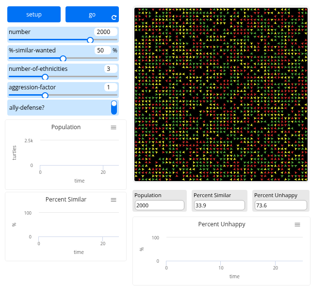
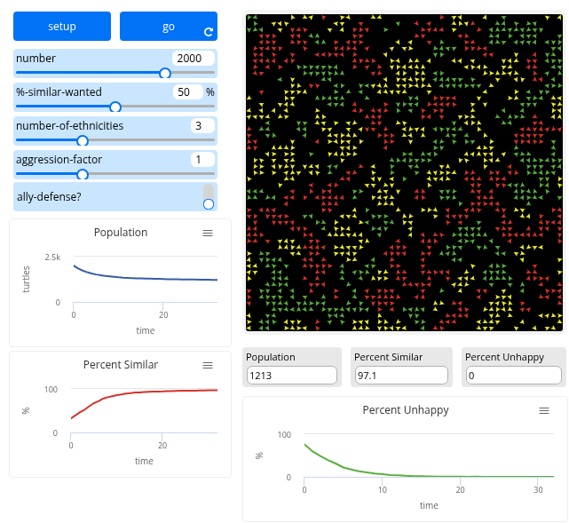
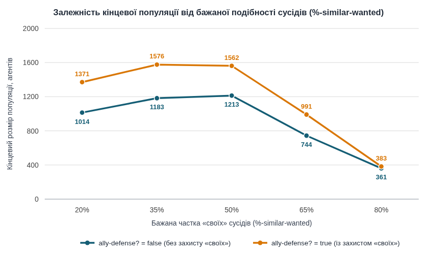
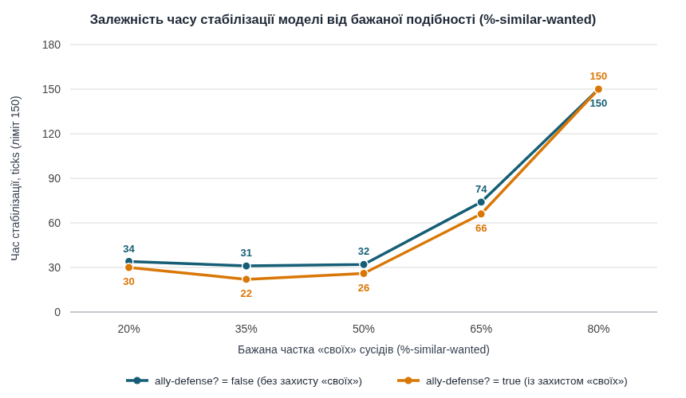

## Комп'ютерні системи імітаційного моделювання
## СПм-25-1, **Шиленко Михайло Павлович**
### Лабораторна робота №**2**. Редагування імітаційних моделей у середовищі NetLogo *(додатковий варіант за Планом «Б»)*

<br>

### Варіант 8, модель у середовищі NetLogo:
[Segregation Simple Extension 1](http://www.netlogoweb.org/launch#http://www.netlogoweb.org/assets/modelslib/IABM%20Textbook/chapter%203/Segregation%20Extensions/Segregation%20Simple%20Extension%201.nlogo)

<br>

### Внесені зміни у вихідну логіку моделі, за варіантом:

**1. Можливість зникнення агента залежно від кількості «чужих» поряд та підтримки їхньої групи в їхньому оточенні.**  
До власних змінних агентів `turtles-own` додано лічильник `other-nearby` (кількість сусідів іншого кольору в 8-зв'язному околі `neighbors`):
```netlogo
turtles-own [
  happy?           ;; true, якщо частка «своїх» сусідів >= %-similar-wanted
  similar-nearby   ;; кількість сусідів свого кольору
  other-nearby     ;; кількість «чужих» сусідів іншого кольору
  total-nearby     ;; загальна кількість сусідів
]
```

На інтерфейс додано керуючий слайдер інтенсивності конфліктності `aggression-factor` (діапазон `0.0 – 3.0`, крок `0.1`, базове значення `1.0`).

Додано процедуру `check-vanish`, яка на кожному такті для кожного агента визначає множину сусідніх «чужих» `enemies = (turtles-on neighbors) with [color != [color] of myself]`. Якщо поруч є хоча б один «чужий», обчислюється сумарна підтримка «чужих» з боку представників їхніх власних груп (`enemy-support = sum [similar-nearby] of enemies`, де `similar-nearby` кожного агента вже оновлено в `update-turtles`). Імовірність зникнення (%) визначається як:
```netlogo
vanish-prob = aggression-factor * (count enemies + 0.5 * enemy-support)
```
Якщо випадкове число `random-float 100 < vanish-prob`, агент зникає з поля (`die`):
```netlogo
to check-vanish
  ask turtles [
    let enemies (turtles-on neighbors) with [ color != [color] of myself ]
    if any? enemies [
      let enemy-support sum [similar-nearby] of enemies
      let vanish-prob aggression-factor * (count enemies + 0.5 * enemy-support)
      if ally-defense? [
        set vanish-prob vanish-prob / (1 + similar-nearby)
      ]
      if random-float 100 < vanish-prob [
        die
      ]
    ]
  ]
end
```

**2. Оновлення головного циклу `go` та захист від ділення на нуль при зменшенні популяції.**  
У процедурі `go` додано виклик `check-vanish`, повторне оновлення станів сусідства `update-turtles` після зникнення агентів та умову зупинки при повному зникненні популяції (`not any? turtles`):
```netlogo
to go
  if not any? turtles or all? turtles [happy?] [ stop ]
  move-unhappy-turtles
  update-turtles
  check-vanish
  update-turtles
  update-globals
  tick
end
```

У процедурі `update-globals` додано безпечні перевірки `total-neighbors > 0` та `any? turtles`:
```netlogo
to update-globals
  let similar-neighbors sum [similar-nearby] of turtles
  let total-neighbors sum [total-nearby] of turtles
  ifelse total-neighbors > 0
    [ set percent-similar (similar-neighbors / total-neighbors) * 100 ]
    [ set percent-similar 0 ]
  ifelse any? turtles
    [ set percent-unhappy (count turtles with [not happy?]) / (count turtles) * 100 ]
    [ set percent-unhappy 0 ]
end
```

**3. Виведення графіка зміни розміру популяції.**  
На інтерфейс додано новий графік **`Population`** (`plot count turtles`, вісь X — `time`, вісь Y — `turtles`) та цифровий монітор **`Population`** (`count turtles`) для відстеження чисельності агентів у реальному часі.

<br>

### Внесені зміни у вихідну логіку моделі, на власний розсуд:

**Механізм захисту з боку власного оточення (перемикач `ally-defense?`).**  
У вихідному варіанті враховується лише підтримка «чужих» сусідів, але не враховується, що агент може стояти в оточенні «своїх». Для логічної симетрії моделі на інтерфейс додано перемикач (Switch) `ally-defense?`. Коли перемикач увімкнено (`true`), наявність «своїх» сусідів (`similar-nearby`) знижує ймовірність зникнення агента у `(1 + similar-nearby)` разів:
```netlogo
      if ally-defense? [
        set vanish-prob vanish-prob / (1 + similar-nearby)
      ]
```
Така доробка не змінює класичне правило задоволеності Шеллінга (`happy?`), є соціально адекватною (одинокий агент серед чужих є значно вразливішим, ніж агент на межі власного кластера) та дозволяє в експерименті безпосередньо порівняти режими без захисту й із захистом.



Фінальний код моделі та оновлений інтерфейс доступні у файлі [Segregation_Lab2.nlogo](Segregation_Lab2.nlogo).

<br>

## Обчислювальні експерименти

### 1. Вплив прагнення до сегрегації (`%-similar-wanted`) та захисту власного оточення (`ally-defense?`) на виживання популяції

Основними показниками роботи системи обрано **кінцевий розмір популяції** (`Population` та **частку тих, хто вижив**, у % від початкових 2000 агентів), **підсумковий відсоток подібних сусідів** (`percent-similar`, %) та **час стабілізації** (`ticks`, коли `percent-unhappy = 0%`, при обмеженні `T = 150 ticks`).

- **Фіксовані параметри:** `number = 2000`, `number-of-ethnicities = 3`, `aggression-factor = 1.0`, ліміт модельного часу `T = 150 ticks`.
- **Змінні параметри:** `%-similar-wanted ∈ {20%, 35%, 50%, 65%, 80%}` у двох режимах: `ally-defense? = false` та `ally-defense? = true`.

#### Серія 1. Режим `ally-defense? = false` (без захисту «своїх»)

| № прогону | Бажана подібність (`%-similar-wanted`), % | Кінцева популяція (`Population`) | Частка тих, хто вижив, % | Підсумкова подібність (`percent-similar`), % | Час стабілізації, `ticks` |
| :---: | :---: | :---: | :---: | :---: | :---: |
| 1 | 20% | 1014 | 50.7% | 90.8% | 34 |
| 2 | 35% | 1183 | 59.2% | 96.7% | 31 |
| 3 | 50% | 1213 | 60.7% | 97.1% | 32 |
| 4 | 65% | 744 | 37.2% | 99.9% | 74 |
| 5 | 80% | 361 | 18.1% | 89.5% | 150 (ліміт) |



#### Серія 2. Режим `ally-defense? = true` (із захистом власного оточення)

| № прогону | Бажана подібність (`%-similar-wanted`), % | Кінцева популяція (`Population`) | Частка тих, хто вижив, % | Підсумкова подібність (`percent-similar`), % | Час стабілізації, `ticks` |
| :---: | :---: | :---: | :---: | :---: | :---: |
| 1 | 20% | 1371 | 68.5% | 76.6% | 30 |
| 2 | 35% | 1576 | 78.8% | 85.5% | 22 |
| 3 | 50% | 1562 | 78.1% | 92.6% | 26 |
| 4 | 65% | 991 | 49.5% | 99.8% | 66 |
| 5 | 80% | 383 | 19.1% | 76.9% | 150 (ліміт) |


#### Порівняльні графіки залежностей





#### Аналіз результатів і висновки

1. **Немонотонний характер залежності виживання від `%-similar-wanted`:** залежність кінцевої популяції від бажаної подібності має виражений максимум у діапазоні **35% – 50%**.
   - При низькому `%-similar-wanted = 20%` агенти миряться зі змішаним сусідством і мало переміщуються, тому довше залишаються поруч із «чужими» й зазнають помітних втрат (`50.7%` виживання при `false`, `68.5%` при `true`).
   - При помірному `%-similar-wanted = 35% – 50%` агенти швидко (за `22 – 32 ticks`) формують однорідні кластери, мінімізуючи контакти з чужими: виживання досягає максимуму — **`60.7%` (1213 агентів)** без захисту та **`78.8%` (1576 агентів)** із захистом.
   - При завищеному `%-similar-wanted = 65% – 80%` агентам важко знайти підходящу клітинку: час стабілізації різко зростає до `66 – 74 ticks` (при `65%`), а при `80%` система взагалі не стабілізується за `150 ticks` (`8.9% – 19.8%` залишаються нещасливими), через що тривалі блукання призводять до виснаження популяції до `18.1% – 19.1%` (361 – 383 агенти).
2. **Вплив власної зміни (`ally-defense?`):** увімкнення захисту від «своїх» сусідів підвищує виживання на **+17.4 – +19.6%** у діапазоні `20% – 50%` і на **+12.3%** при `65%`, а також скорочує час виходу в рівновагу (наприклад, `22 ticks` проти `31` при `35%`).
3. **Узгодженість із сегрегацією:** у режимі `ally-defense? = false` підсумковий `percent-similar` вищий (`90.8% – 99.9%` проти `76.6% – 99.8%` при `true`), оскільки без захисту прикордонні агенти на стиках груп зникають значно швидше, утворюючи порожні «буферні» проміжки між кластерами (це чітко видно на Рисунку 2 порівняно з Рисунком 3).
